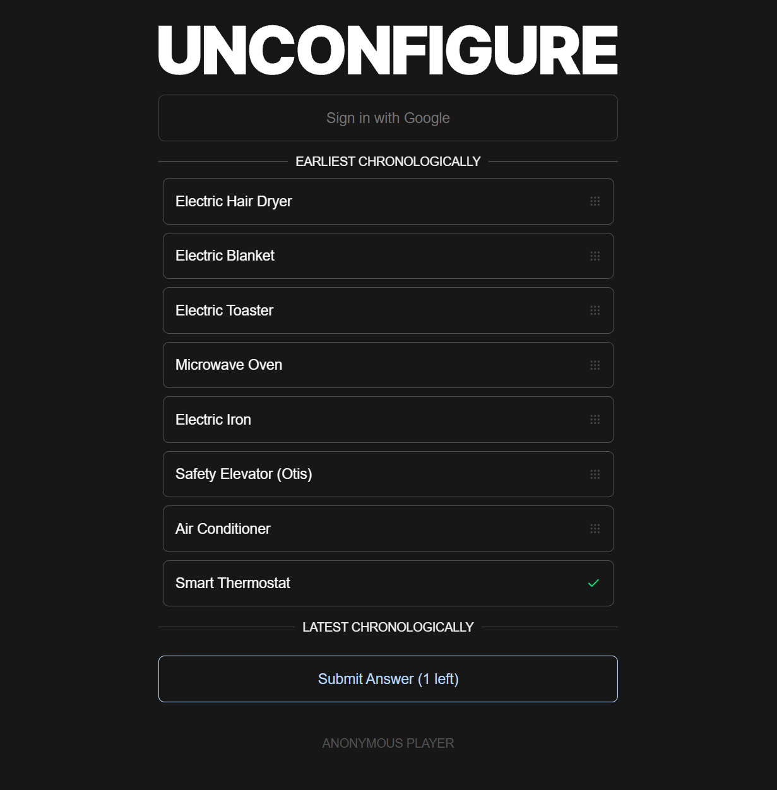

# Unconfigure

**Unconfigure** is a bite-sized daily timeline puzzle. Each day you get a shuffled list of inventions, discoveries, or cultural moments. Drag them into chronological order in as few guesses as possible.

**Play it:** [unconfigure.com](https://unconfigure.com)



## Features

- **Drag-and-drop gameplay** powered by [`@dnd-kit`](https://github.com/clauderic/dnd-kit).
- **Limited attempts and animated reveals** keep rounds fast.
- **Locked-in correctness**: once an item is in the right spot it can't be moved.
- **Daily challenge and share card** for friendly bragging rights.
- **Saved progress and history** for players who sign in with Google, stored per user in Supabase.
- **Admin scheduling**: an admin area for drafting, editing, and publishing future daily games.

## Stack

| Stack | Why |
|-------|-----|
| Next.js (App Router) | File-based routing and API routes |
| Tailwind CSS | Utility-first styling |
| Zustand | Lightweight client state |
| Supabase | Postgres, Google sign-in, and Row Level Security |
| Motion | Page and result transitions |
| canvas-confetti | Celebrating a solved puzzle |

## Backend and security

Database changes live in versioned migrations under [`supabase/migrations`](supabase/migrations), with rollout notes in [`supabase/README.md`](supabase/README.md). Highlights:

- Player progress is owned by the authenticated Supabase user and protected by owner-only RLS policies.
- Public clients can't read the `daily_games` table directly. A narrow `get_daily_game` function returns only published games dated on or before today, so future answers can't be downloaded.
- Games move through explicit `draft` and `published` states, and a game can only be published once its content is complete.

## Quick start

1. Clone and install:

   ```bash
   git clone https://github.com/jacobthomasjohnson/unconfigure.git
   cd unconfigure
   npm install
   ```

2. Add your Supabase keys:

   ```bash
   cp .env.example .env.local   # then fill in the two values
   ```

3. Apply the migrations in `supabase/migrations` to your Supabase project (see `supabase/README.md`).

4. Start the dev server and open http://localhost:3000:

   ```bash
   npm run dev
   ```

## Testing

```bash
npm test     # node --test, 34 tests covering daily games, progress, auth redirects, and admin drafts
npm run lint
```

## Roadmap

See the [project wiki](https://github.com/jacobthomasjohnson/unconfigure/wiki) for the 2026-2027 roadmap.
